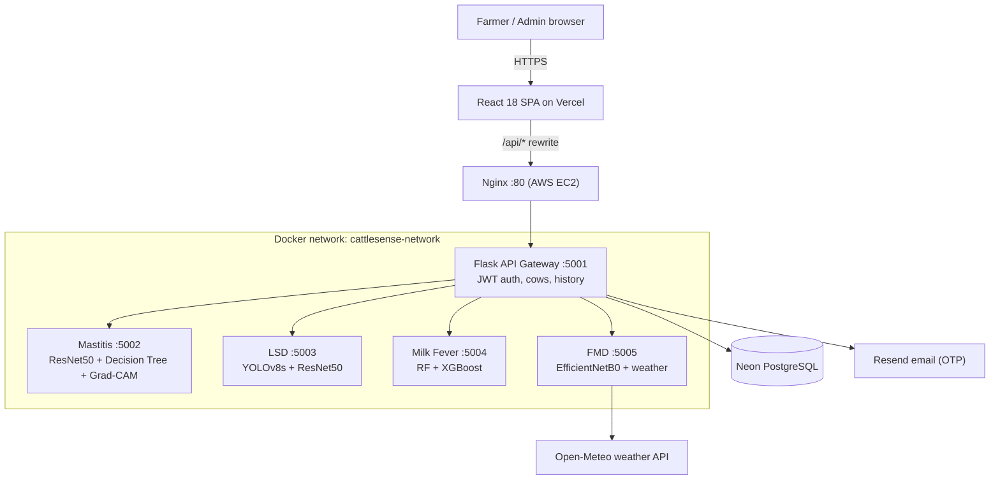

# CattleSense: Machine Learning based Early Detection of Cattle Diseases

[](#research-team)
[](#technology-stack)
[](#technology-stack)
[](#how-to-run)

**Live web app:** https://cattlesensesl.vercel.app/

---

## Table of Contents
1. [Summary](#summary)
2. [Research Team](#research-team)
3. [System Architecture](#system-architecture)
4. [Machine Learning Modules](#machine-learning-modules)
5. [Results](#results)
6. [Datasets](#datasets)
7. [Testing](#testing)
8. [How to Run](#how-to-run)
9. [Field Validation](#field-validation)
10. [Services and Ports](#services-and-ports)
11. [Technology Stack](#technology-stack)
12. [REST API](#rest-api)
13. [Security](#security)
14. [Known Limitations and Future Work](#known-limitations-and-future-work)
15. [Repository Structure](#repository-structure)
16. [Acknowledgements](#acknowledgements)
17. [License](#license)
18. [Citation](#citation)

---

## Summary

Mastitis, Foot and Mouth Disease (FMD), Lumpy Skin Disease (LSD) and Milk Fever are four common cattle diseases in Sri Lanka. They reduce milk production, harm animal welfare and can cause death when they are found late. Veterinarians are not always available, especially for small farmers.

**CattleSense** is a web platform that helps farmers detect these four diseases early. One platform covers all four diseases, and each disease has its own machine learning module:

1. **Images**: deep learning models (ResNet50, EfficientNetB0, YOLOv8s) check photos of the udder, lesions or skin.
2. **Measurements and signs**: classical ML models (Decision Tree, Random Forest, XGBoost) use milk measurements, herd information and symptom checklists entered by the farmer.
3. **Weather**: live weather from Open-Meteo is used for FMD risk and for heat stress (THI) in Milk Fever.
4. **Explanation and reports**: Grad-CAM heatmaps show which part of the image drove the result, and every module produces a PDF report in **English and Sinhala**.

---

## Research Team

**Group ID:** `R26-IT-045`
**Institution:** Sri Lanka Institute of Information Technology (SLIIT)
**Specialization:** BSc (Hons) in Information Technology

| Student ID | Name | Component | Main Methods | Port |
| :--- | :--- | :--- | :--- | :--- |
| IT22153036 | Perera L. C. C. | Mastitis Detection | ResNet50 + Decision Tree (5 biomarkers) + Grad-CAM + severity staging | `5002` |
| IT22129512 | Sudasinghe D. D. | Foot and Mouth Disease | EfficientNetB0 + clinical rules + Open-Meteo weather risk | `5005` |
| IT22282422 | Manathunga M. A. A. S. | Lumpy Skin Disease | YOLOv8s + ResNet50 + 70/30 image–symptom fusion | `5003` |
| IT22221728 | Udawaththa M. P. A. M. | Milk Fever | Random Forest + XGBoost soft voting + SMOTE + THI | `5004` |

---

## System Architecture

CattleSense uses a **microservice + API gateway** design.

* The **React frontend** is hosted on **Vercel**. All API calls use the relative path `/api/...`.
* `vercel.json` rewrites `/api/:path*` to the EC2 server, so the browser only talks to the HTTPS Vercel domain.
* On **AWS EC2**, **Nginx (port 80)** forwards requests to the **Flask API gateway (port 5001)**.
* The gateway handles login, JWT tokens, cow records and history, and forwards prediction requests to the four ML services on a private Docker network (`cattlesense-network`).
* The four ML services are not exposed to the internet.



---

## Machine Learning Modules

### 1. Mastitis Detection
* **Folder:** `mastitis-module/` | **Port:** `5002` | **Member:** Perera L. C. C. (IT22153036)
* **Image model:** ResNet50 classifies the udder photo.
* **Biomarker model:** Decision Tree on 5 milk measurements:
  1. Milk temperature (°C)
  2. Milk pH
  3. Electrical conductivity (mS/cm)
  4. Milk yield (L/day)
  5. Clotting (yes / no)
* **Fusion:** the two probabilities are combined with **soft voting**, and the symptom checklist is blended in with a **15% weight**.
* **Borderline cases:** results within **±0.15** of the decision line are marked as borderline.
* **Severity:** every positive case gets a stage: **Mild, Moderate or Severe**, with guidance for the farmer.
* **Explainability:** Grad-CAM heatmap on the udder photo.
* **Speed:** about **78 ms** per prediction.
* **Report:** PDF report in English and Sinhala.

### 2. Foot and Mouth Disease (FMD)
* **Folder:** `fmd-module/` | **Port:** `5005` | **Member:** Sudasinghe D. D. (IT22129512)
* **Image model:** EfficientNetB0 classifies photos of the mouth, tongue, hoof or teat as healthy (`0`) or FMD lesion (`1`).
* **Clinical rules:** score the signs reported by the farmer (fever, salivation, reduced feeding, lameness and others).
* **Environmental risk:** live Open-Meteo weather for the farmer's district, plus a seasonal rule for **December to February**.
* **Fusion:** the image, clinical and environmental results are combined into one FMD assessment.
* **Report:** weather view and PDF report in English and Sinhala.

### 3. Lumpy Skin Disease (LSD)
* **Folder:** `lumpy-module/` | **Port:** `5003` | **Member:** Manathunga M. A. A. S. (IT22282422)
* **Stage 1:** YOLOv8s finds and marks skin nodules on the photo.
* **Stage 2:** ResNet50 classifies the image.
* **Fusion:** **70%** image result + **30%** weighted symptom checklist (lymph nodes, fever, milk drop, appetite, nasal and eye discharge, temperature).
* **Risk levels:** Low (below 30), Moderate (30 to 70), High (70 and above).
* **Report:** PDF report in English and Sinhala.

### 4. Milk Fever
* **Folder:** `milk-fever-module/` | **Port:** `5004` | **Member:** Udawaththa M. P. A. M. (IT22221728)
* **Model:** soft-voting ensemble of **Random Forest** and **XGBoost**, with **SMOTE** to balance the rare critical cases.
* **Stages:** Subclinical, Mild, Moderate and Critical, shown as a 0–100 risk score (0–24, 25–49, 50–69, 70–100).
* **Heat stress:** hot and humid weather (THI) can add up to **15 points** to the risk score.
* **Output:** stage, risk score, main risk factors, nutrition and management advice, urgent warning for critical cases and a PDF report.

---

## Results

All results are on held-out test data.

| Module | Model | Accuracy | ROC-AUC | Other key result |
| :--- | :--- | :--- | :--- | :--- |
| **Mastitis** | ResNet50 (image) | **87.01%** | **0.9376** | Precision 91.45%, recall 89.17% |
| **Mastitis** | Decision Tree (biomarkers) | **99.38%** | – | – |
| **FMD** | EfficientNetB0 | **94.1%** | **0.971** | FMD recall 96.2% |
| **LSD** | YOLOv8s + ResNet50 | **93.10%** | **0.9637** | 48 of 49 LSD cases detected |
| **Milk Fever** | RF + XGBoost ensemble | **97.04%** | **0.9986** | Critical-stage recall 93.97%, 5-fold CV 98.15% ± 0.23% |

---

## Datasets

| Module | Data used |
| :--- | :--- |
| Mastitis | Udder images (normal / mastitis) and a tabular dataset of 5 milk biomarkers |
| FMD | Images of mouth, tongue, hoof and teat (healthy / FMD lesion) |
| LSD | Cattle skin images (healthy / LSD) used for the YOLOv8s detector and the ResNet50 classifier |
| Milk Fever | Tabular herd and calving records |

Datasets and trained model files are not fully included in this repository because of their size.

---

## Testing

| Test suite | Tests | Result |
| :--- | :--- | :--- |
| API gateway (pytest) | 22 | ✅ All pass |
| Mastitis module (pytest) | 87 | ✅ All pass |
| FMD module (pytest) | 61 | ✅ All pass |
| Milk Fever module (pytest) | 4 | ✅ All pass |
| Frontend (Vitest) | 16 | ✅ All pass |
| LSD module | – | No automated tests yet |

Run the tests:

```bash
# Python services (run inside each folder: backend, mastitis-module, fmd-module, milk-fever-module)
pytest

# Frontend
cd frontend
npm install
npx vitest run
```

---

## How to Run

```bash
git clone https://github.com/chamara2002/R26-IT-045.git
cd R26-IT-045
cp .env.docker.example .env        # add DATABASE_URL, JWT secret and email API key
# place the trained model files in each module's models/ folder
docker compose up -d --build       # gateway + 4 ML services

cd frontend
npm install
npm run dev                        # http://localhost:5173
```

---

## Field Validation

* The system was demonstrated to the **Chief Epidemiologist, Animal Health Division, Department of Animal Production and Health (DAPH)**, and to farmers.
* The Chief Epidemiologist said the system is important, that he had not seen a similar system in Sri Lanka, that it can be used on large-scale farms, and that it can help where veterinarians are scarce and where late detection causes animal deaths.
* The Chief Epidemiologist also gave a **letter of support** for the research.
* Farmer feedback was mixed: some farmers found it easy and useful, and others said they need guidance to learn how to use it.

---

## Services and Ports

| Service | Container | Technology | Port |
| :--- | :--- | :--- | :--- |
| Nginx reverse proxy | `cattlesense-nginx` | Nginx Alpine | `80` (public) |
| API gateway | `cattlesense-backend` | Flask 3.1 / Python 3.11 | `5001` |
| Mastitis service | `cattlesense-mastitis` | TensorFlow / Python 3.11 | `5002` |
| LSD service | `cattlesense-lumpy` | Ultralytics YOLOv8 / PyTorch | `5003` |
| Milk Fever service | `cattlesense-milk-fever` | XGBoost / Scikit-Learn | `5004` |
| FMD service | `cattlesense-fmd` | TensorFlow 2.14 / Python 3.11 | `5005` |
| Frontend (optional, local only) | `cattlesense-frontend` | React 18 / Nginx | profile-only |
| Database | Neon (hosted) | PostgreSQL (SSL) | – |

Every service has a `GET /health` endpoint and a Docker health check.

---

## Technology Stack

* **Frontend:** React 18, Vite, Tailwind CSS, Axios, Chart.js, Vitest. Hosted on Vercel.
* **Backend gateway:** Python 3.11, Flask 3.1, Flask-SQLAlchemy, Flask-CORS, JWT, Werkzeug password hashing.
* **Machine learning:** TensorFlow / Keras, PyTorch, Ultralytics YOLOv8, XGBoost, Scikit-Learn, Imbalanced-Learn (SMOTE), OpenCV, NumPy, Pandas, Pillow.
* **Reports:** PDF generation with Sinhala font support (Noto Sans Sinhala).
* **Database:** PostgreSQL on Neon.
* **External APIs:** Open-Meteo (weather), Resend (OTP email).
* **DevOps:** Docker, Docker Compose, Nginx, Ubuntu Server, AWS EC2.

---

## REST API

### Authentication
| Method | Endpoint | Access | Description |
| :--- | :--- | :--- | :--- |
| `POST` | `/api/auth/register` | Public | Register a farmer account |
| `POST` | `/api/auth/login` | Public | Log in and get a JWT |
| `GET` | `/api/auth/me` | User | Current user profile |
| `POST` | `/api/auth/forgot-password` | Public | Send password reset OTP by email |
| `POST` | `/api/auth/reset-password` | Public | Check OTP and set a new password |

### Cattle
| Method | Endpoint | Access | Description |
| :--- | :--- | :--- | :--- |
| `GET` | `/api/cows` | User | List the user's cows |
| `POST` | `/api/cows` | User | Add a cow |
| `GET` | `/api/cows/<cow_id>` | User (owner) | Cow profile and history |
| `PUT` | `/api/cows/<cow_id>` | User (owner) | Update a cow |
| `DELETE` | `/api/cows/<cow_id>` | User (owner) | Delete a cow |

### Disease detection (through the gateway)
| Method | Endpoint | Service | Description |
| :--- | :--- | :--- | :--- |
| `POST` | `/api/modules/mastitis/predict` | mastitis :5002 | Prediction from the 5 biomarkers |
| `POST` | `/api/modules/mastitis/predict-image` | mastitis :5002 | Prediction from an udder photo |
| `POST` | `/api/modules/mastitis/predict-assisted` | mastitis :5002 | Full image + biomarker + symptom prediction with Grad-CAM |
| `GET` | `/api/modules/mastitis/heatmap/<id>` | mastitis :5002 | Get a Grad-CAM heatmap |
| `POST` | `/api/modules/fmd/predict` | fmd :5005 | FMD image, clinical and weather assessment |
| `POST` | `/api/modules/lumpy/predict-assisted` | lumpy :5003 | LSD image + symptom assessment |
| `POST` | `/api/modules/milk-fever/predict` | milk-fever :5004 | Milk fever stage and risk score |

### Admin
| Method | Endpoint | Access | Description |
| :--- | :--- | :--- | :--- |
| `GET` | `/api/admin/stats` | Admin | System statistics for the admin dashboard |

---

## Security

* **Passwords** are hashed with Werkzeug.
* **JWT tokens** expire after **8 hours**.
* **Roles:** `farmer` and `admin` are separated.
* **Ownership check:** a user can only see and change their own cows and results.
* **Database:** Neon PostgreSQL over SSL.
* **Network:** the ML services are only reachable inside the Docker network. Only Nginx (port 80) is public.
* **Secrets:** `.env` files are not committed to Git.
* **Auto restart:** services restart automatically and have health checks.

---

## Known Limitations and Future Work

* **LSD automated tests** are not added yet.
* **FMD dataset** is small and has no animal ID, so images of the same animal may appear in both training and test sets. This is documented in the model metadata.
* **Farmer usability:** some farmers need help to learn the system. Planned: simple training sessions and an in-app guide.
* **Smaller models:** lighter models (for example TFLite) would make the system faster to host and run.
* **Mobile app and offline use** are planned as future work.

---

## Repository Structure

```
R26-IT-045/
├── docker-compose.yml          # Runs all services
├── .env.docker.example         # Environment template
├── vercel.json                 # Vercel /api rewrite to EC2
├── README.md
│
├── nginx/                      # Nginx reverse proxy (port 80)
│
├── backend/                    # Flask API gateway
│   ├── app.py
│   ├── models/                 # User, Cow, detection logs
│   ├── routes/                 # auth, cows, modules, admin, dashboard
│   └── services/               # proxy, auth, email
│
├── mastitis-module/            # Mastitis service (port 5002)
│   ├── api/flask_api.py
│   ├── config/config.py
│   ├── models/                 # ResNet50 and Decision Tree models
│   └── utils/                  # Grad-CAM, severity engine, PDF report
│
├── fmd-module/                 # FMD service (port 5005)
│   ├── src/training/           # train, predict, hybrid logic
│   ├── src/utils/              # image validator
│   ├── models/model/           # trained model (not in Git)
│   └── weather/                # Open-Meteo and seasonal risk
│
├── lumpy-module/               # LSD service (port 5003)
│   ├── app.py
│   ├── inference/              # YOLOv8s + ResNet50 pipeline, fusion
│   └── assets/fonts/           # Sinhala fonts for PDF
│
├── milk-fever-module/          # Milk Fever service (port 5004)
│   ├── app.py
│   ├── utils/                  # preprocessor, predictor, PDF report
│   ├── charts/                 # analysis charts
│   └── tests/
│
└── frontend/                   # React 18 + Vite + Tailwind
    ├── src/
    └── src/test/               # Vitest tests
```

---

## Acknowledgements

We sincerely thank everyone who helped us during this research, including those who guided us, shared their knowledge, reviewed the system, gave feedback and allowed us to visit their farms.

---

## License

This project was developed for academic and research purposes. Please contact the authors before using it for any other purpose.

---

## Citation

This project was developed as the final year research project for the BSc (Hons) in Information Technology at the **Sri Lanka Institute of Information Technology (SLIIT)**.

```bibtex
@misc{cattlesense2026,
  title={CattleSense: Machine Learning based Early Detection of Cattle Diseases},
  author={Perera, L. C. C. and Sudasinghe, D. D. and Manathunga, M. A. A. S. and Udawaththa, M. P. A. M.},
  year={2026},
  institution={Sri Lanka Institute of Information Technology}
}
```